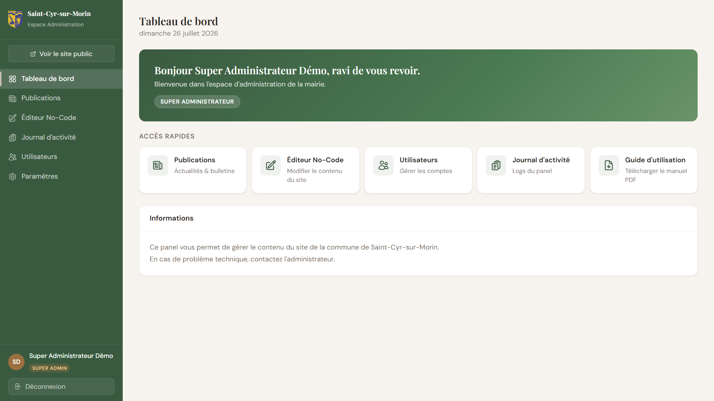
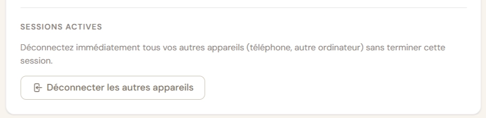

# Guide d’utilisation — Espace d’administration

# Mairie de Saint-Cyr-sur-Morin

---

> Ce guide est destiné à toutes les personnes ayant accès au panel d’administration du site de la commune. Il couvre l’ensemble des fonctionnalités disponibles, des plus simples aux plus avancées. Lisez-le à votre rythme, revenez-y en cas de doute — il est conçu pour répondre à presque toutes les situations que vous pouvez rencontrer.
> 

---

<aside>

</aside>

---

# Comprendre les niveaux d’accès

Tout le monde n’a pas accès aux mêmes fonctionnalités dans le panel. Cela dépend du **rôle** qui vous a été attribué lors de la création de votre compte.

## Les trois rôles

**Super Administrateur**
C’est le niveau d’accès le plus élevé. Il a la main sur absolument tout le panel, y compris la gestion des autres administrateurs. Ce rôle est réservé au gestionnaire technique du site.

**Administrateur**
Accès complet à toutes les fonctionnalités du panel : publications, éditeur no-code, journal d’activité, gestion des utilisateurs. La seule limite : un administrateur ne peut pas créer, modifier ni supprimer un compte Super Administrateur.

**Employé**
Accès limité aux sections pour lesquelles vous avez été autorisé. Par exemple, un employé responsable des actualités verra l’onglet Publications mais pas forcément l’Éditeur. C’est l’administrateur qui décide de vos droits au cas par cas.

## Les permissions d’un employé

En plus du rôle, chaque employé peut se voir attribuer des **permissions spécifiques** qui donnent accès à certaines parties du site :

| Permission | Ce que ça donne accès |
| --- | --- |
| La Commune | Section “La Commune” dans l’Éditeur |
| Vie Pratique | Section “Vie Pratique” dans l’Éditeur |
| Urbanisme | Section “Urbanisme” dans l’Éditeur |
| SIVU | Section “SIVU” dans l’Éditeur |
| Vie Locale | Section “Vie Locale” dans l’Éditeur |
| Découvrir | Section “Découvrir” dans l’Éditeur (à venir) |
| Publications | Onglet Publications complet (articles, arrêtés, CR, TDU) |
| Médiathèque | Onglet Médiathèque dans les Publications |

<aside>
💡

Vous pouvez consulter vos propres droits à tout moment depuis la page **Paramètres**, en bas de la section “Mes droits & autorisations”.

</aside>

---

# Partie 1 — Connexion et gestion de son compte

## 1.1 Se connecter

Rendez-vous à l’adresse du panel (communiquée par l’administrateur). Vous arrivez sur une page de connexion sobre, aux couleurs de la commune.

1. Entrez votre **adresse e-mail** dans le premier champ.
2. Entrez votre **mot de passe** dans le second.
3. Cliquez sur **Se connecter**.

Si tout est correct, vous arrivez directement sur le tableau de bord.

Si vous voyez un message d’erreur en rouge sous le formulaire, voici les cas possibles :

- *“Identifiants incorrects”* → vérifiez votre adresse e-mail et votre mot de passe. Attention aux majuscules.
- *“Trop de tentatives”* → le système bloque temporairement après plusieurs erreurs. Attendez quelques minutes.
- Autre message → contactez l’administrateur.

<aside>
⚠️

Ne partagez jamais votre mot de passe avec quelqu’un d’autre. Chaque compte est personnel et toutes les actions effectuées dans le panel sont enregistrées sous votre nom.

</aside>

---

## 1.2 Vous avez oublié votre mot de passe ?

Sur la page de connexion, vous trouverez le lien **“Mot de passe oublié ?”** juste à droite du champ mot de passe.

1. Cliquez sur ce lien.
2. Entrez l’adresse e-mail associée à votre compte.
3. Cliquez sur **Envoyer le lien**.
4. Vous recevrez un e-mail dans les minutes qui suivent. Si vous ne le voyez pas, vérifiez vos **spams ou courrier indésirable**.
5. Cliquez sur le lien dans l’e-mail. Vous serez redirigé vers une page sécurisée pour définir un nouveau mot de passe.
6. Entrez votre nouveau mot de passe (8 caractères minimum), confirmez-le, puis validez.
7. Vous êtes redirigé vers la page de connexion. Connectez-vous avec votre nouveau mot de passe.

<aside>
💡

Le lien envoyé par e-mail est à usage unique et expire rapidement. Si vous n’arrivez pas à l’utiliser, refaites la procédure depuis le début.

</aside>

---

## 1.3 Premier accès — vous venez de recevoir un e-mail d’invitation

Quand un administrateur crée votre compte, vous recevez un **e-mail d’invitation** automatique. Il ressemble à ceci :

- **Expéditeur :** l’adresse liée au panel de la mairie
- **Objet :** invitation à l’espace d’administration
- **Contenu :** un bouton ou lien pour définir votre mot de passe

La procédure est simple :

1. Ouvrez l’e-mail et cliquez sur le lien ou le bouton.
2. Vous arrivez sur une page “Bienvenue” qui vous invite à définir votre mot de passe.
3. Choisissez un mot de passe (8 caractères minimum), confirmez-le, et validez.
4. Vous êtes automatiquement redirigé vers le tableau de bord — vous êtes connecté.

<aside>
⚠️

Le lien d’invitation est personnel. Ne le transmettez pas à quelqu’un d’autre. Si le lien a expiré (vous l’avez reçu il y a plusieurs jours par exemple), contactez l’administrateur pour qu’il envoie une nouvelle invitation.

</aside>

---

## 1.4 Se déconnecter

Pour vous déconnecter, rendez-vous dans le bas de la barre de navigation à gauche. Vous y trouverez un bouton **Déconnexion** avec votre nom affiché juste au-dessus.

Sur téléphone ou tablette, appuyez d’abord sur l’icône menu (les trois lignes en haut à gauche) pour faire apparaître la barre de navigation, puis appuyez sur Déconnexion.

<aside>
💡

Si vous utilisez un ordinateur partagé (salle du personnel, bureau commun), pensez toujours à vous déconnecter avant de quitter. Votre session ne se termine pas automatiquement.

</aside>

**Déconnecter vos autres appareils :** Si vous êtes connecté simultanément sur votre téléphone et votre ordinateur, vous pouvez mettre fin aux sessions actives sur les autres appareils sans vous déconnecter de celui que vous utilisez. Cette option se trouve dans **Paramètres → Sécurité → Déconnecter les autres appareils**.

## 1.5 Basculer sur le site public

Juste en dessous du titre “Espace Administration” tout en haut de votre barre de navigation gauche, vous disposez d'un accès direct au site officiel de la commune.

1. Cliquez sur le bouton **Voir le site public**.
2. Le site internet de Saint-Cyr-sur-Morin s'ouvre automatiquement dans un **nouvel onglet** de votre navigateur.

Cela vous permet de naviguer sur le site visible par les habitants tout en gardant votre session d'administration ouverte dans l'onglet précédent.

<aside>
💡

**Astuce :** Après avoir cliqué sur **Enregistrer** dans l'éditeur ou publié une actualité, utilisez ce bouton pour aller vérifier instantanément le rendu visuel sur le site public. Si les modifications n'apparaissent pas, pensez à rafraîchir la page de votre navigateur (touche F5 ou l'icône de flèche en cercle).

</aside>

---

# Partie 2 — Le tableau de bord

Le tableau de bord est la première page que vous voyez après connexion. Il est volontairement épuré.

**Ce que vous y trouvez :**

- **Le bandeau de bienvenue** — votre prénom, votre nom et votre rôle s’affichent. C’est une confirmation que vous êtes bien connecté avec le bon compte.
- **Les accès rapides** — des raccourcis vers les sections auxquelles vous avez accès. Ils s’adaptent automatiquement à vos permissions : vous ne verrez pas de lien vers une section qui ne vous est pas accessible.
- **Un bloc d’informations** — quelques rappels utiles.

<aside>
💡

Si vous ne voyez qu’un ou deux raccourcis alors que vous pensez avoir plus d’accès, contactez l’administrateur pour vérifier vos permissions.

</aside>

---

# Partie 3 — Les Publications

La section Publications regroupe tout ce qui peut être **publié sur le site** : actualités, documents officiels, bulletins municipaux, et événements de la médiathèque.

Vous y accédez via le menu latéral gauche, rubrique **Publications**.

Les onglets disponibles dépendent de vos droits :

- Si vous avez la permission **Publications** : vous voyez Articles, Arrêtés, Comptes-rendus, Trait d’Union.
- Si vous avez la permission **Médiathèque** : vous voyez uniquement l’onglet Médiathèque.
- Si vous avez les deux : tous les onglets sont visibles.

---

## ⚠️ À retenir absolument : le principe du brouillon

**Tout ce que vous créez est en brouillon par défaut.** Cela signifie que c’est invisible sur le site tant que vous ne l’avez pas publié.

C’est une sécurité volontaire : vous pouvez préparer un article, le rédiger et le corriger tranquillement, sans que les visiteurs du site le voient. Quand il est prêt, vous le publiez d’un clic.

Il existe deux façons de publier :

- Le bouton **Publier** (en vert) — rend l’élément immédiatement visible sur le site.
- Le bouton **Enregistrer le brouillon** (en blanc/gris) — sauvegarde sans publier.

Pour vérifier l’état d’un élément dans la liste, regardez la colonne **Statut** :

- 🟡 *Brouillon* — non visible sur le site
- 🟢 *Publié* — visible sur le site

Vous pouvez repasser un élément en brouillon à tout moment en cliquant sur “Modifier” puis en décochant le mode brouillon et en cliquant “Enregistrer le brouillon”, ou inversement.

---

## 3.1 Articles

Les articles correspondent aux **actualités** publiées sur le site. Ils apparaissent sur la page Actualités et, pour certains, dans le carrousel de la page d’accueil.

### Créer un article

1. Allez dans **Publications → Articles**.
2. Cliquez sur le bouton **Nouvel article** en haut à droite.

1. Vous arrivez sur un formulaire en pleine page. Remplissez les champs :

**Titre** *(obligatoire)*
Le titre principal de l’article, tel qu’il apparaîtra sur le site. Soyez clair et concis.

**Catégorie**
Choisissez parmi les catégories disponibles :

- *Travaux* — chantiers, rénovations, aménagements en cours ou à venir
- *Conseil municipal* — délibérations, décisions du conseil
- *Événements* — manifestations, festivités, rencontres
- *Culture* — expositions, spectacles, vie culturelle
- *Prévention* — sécurité, santé, vigilance
- *Bulletin* — renvois vers des bulletins ou documents d’information

<aside>
💡

Lorsque vous choisissez la catégorie **Événements**, deux champs supplémentaires apparaissent : la **date de l’événement** *(obligatoire)* et les **horaires** *(optionnels, ex : 10h – 12h)*. Ces informations permettent d’afficher automatiquement le prochain événement à venir dans la carte d’accueil du site (section héro de la page d’accueil). Si aucun événement futur n’est publié, cette carte n’apparaît pas.

</aside>

**Auteur**
Par défaut, le nom “La Mairie” est indiqué. Vous pouvez le modifier si l’article est signé d’une personne ou d’un service en particulier.

**URL de l’image de couverture** *(optionnelle)*
Importez ou indiquez l’image qui illustrera l’article. Si vous n’en mettez pas, une image par défaut sera utilisée.

**Image de couverture** *(optionnelle)*
Cliquez sur la zone d’import ou glissez-déposez votre image directement dessus. Pour remplacer une image déjà présente, importez simplement la nouvelle — elle remplace l’ancienne automatiquement. Pour la supprimer, cliquez sur le bouton de suppression qui apparaît sur la zone. Si vous n’importez pas d’image, une image par défaut sera utilisée.

**Résumé**
Un court texte (2 à 3 phrases) qui apparaît dans la liste des actualités, avant que le visiteur clique pour lire l’article complet. Pensez à ce résumé comme à l’accroche que vous lisez sous un titre de journal.

**Contenu de l’article**
C’est la zone principale de rédaction. Vous disposez d’une barre d’outils pour mettre en forme votre texte :

- **G** (Gras) et *I* (Italique) — pour mettre en valeur des mots ou des passages
- **H2** et **H3** — pour créer des titres de section à l’intérieur de l’article
- **• Liste** — pour créer une liste à puces
- **1. Liste** — pour créer une liste numérotée
- **❝ Encadré** — pour mettre un passage en évidence dans un bloc citation
- **🔗 Lien** — pour insérer un lien vers une page ou un document

<aside>
💡

Pour insérer un lien, sélectionnez d’abord le texte que vous voulez transformer en lien, puis cliquez sur l’icône 🔗. Une fenêtre vous demande l’adresse (URL) vers laquelle pointer.

</aside>

**Mis en avant** (toggle à droite)
Si vous activez cette option, l’article apparaîtra dans le carrousel “En ce moment à Saint-Cyr-sur-Morin” sur la page d’accueil. Réservez cet espace aux actualités les plus importantes du moment.

**Brouillon** (toggle à droite)
Activé par défaut. Désactivez-le si vous voulez publier directement, ou laissez-le et utilisez les boutons en haut pour choisir.

1. Quand votre article est prêt, utilisez l’un des boutons en haut de page :
    - **Enregistrer le brouillon** — sauvegarde sans publier
    - **Publier** — sauvegarde et rend l’article visible immédiatement sur le site
2. Vous êtes redirigé vers la liste des articles.

### Modifier un article existant

Dans la liste, cliquez sur le bouton **Modifier** à droite de l’article concerné. Vous retrouvez le même formulaire, pré-rempli avec les informations existantes. Modifiez ce que vous souhaitez, puis cliquez **Publier** ou **Enregistrer le brouillon**.

### Mettre un article en avant (bento page d’accueil)

Ouvrez l’article en cliquant sur **Modifier**, puis activez le toggle **Mis en avant** dans la colonne de droite, et cliquez **Publier**.

<aside>
⚠️

Évitez de mettre trop d’articles en avant simultanément — 2 à 6 articles récents et pertinents donnent un bento efficace. Un bento avec 15 articles “en avant” perd de son sens.

</aside>

### Supprimer un article

Dans la liste, cliquez sur **Supprimer** à droite de l’article. Une fenêtre de confirmation apparaît — lisez-la avant de valider, car **cette action est irréversible**.

<aside>
💡

Si vous hésitez à supprimer définitivement un article, préférez le repasser en brouillon : il disparaît du site mais reste accessible dans le panel.

</aside>

---

## 3.2 Arrêtés

Les arrêtés sont des actes administratifs officiels pris par le Maire. Ils ont valeur légale et sont publiés pour information des administrés.

### Ajouter un arrêté

1. Dans **Publications**, cliquez sur l’onglet **Arrêtés**.
2. Cliquez sur **Nouvel arrêté**.

1. Une fenêtre s’ouvre. Remplissez les champs :

**N° de l’arrêté**
Le numéro de référence officiel, au format *AAAA-NNN* (ex : 2026-012). Ce champ est facultatif mais fortement recommandé pour la traçabilité.

**Titre** *(obligatoire)*
L’objet de l’arrêté, tel qu’il apparaîtra sur le site. Exemple : *Arrêté portant réglementation de la circulation rue des Montgoins*.

**Document (PDF)**
Cliquez sur la zone d’import ou glissez-déposez le fichier PDF. Ce document sera téléchargeable par les visiteurs. Vous pouvez le remplacer à tout moment en important un nouveau fichier.

**Pris le**
Date à laquelle l’arrêté a été pris (format JJ/MM/AAAA via le calendrier).

**En vigueur le**
Date d’entrée en vigueur de l’arrêté. Peut être identique à “Pris le” ou postérieure.

**Brouillon**
Activé par défaut. Désactivez-le pour que l’arrêté soit visible sur le site dès l’enregistrement.

1. Cliquez **Enregistrer**.

### Modifier ou supprimer un arrêté

Cliquez sur **Modifier** pour corriger les informations. Cliquez sur **Supprimer** pour effacer l’arrêté (action irréversible — là encore, préférez le brouillon si vous n’êtes pas sûr).

---

## 3.3 Comptes-rendus du conseil municipal

Les comptes-rendus permettent aux administrés de consulter les décisions prises lors des séances du conseil municipal.

### Ajouter un compte-rendu

1. Dans **Publications**, cliquez sur l’onglet **Comptes-rendus**.
2. Cliquez sur **Nouveau compte-rendu**.

1. Dans la fenêtre :

**Date du conseil** *(obligatoire)*
La date à laquelle s’est tenue la séance du conseil municipal.

**Document (PDF)** *(obligatoire)*
Cliquez sur la zone d’import ou glissez-déposez le fichier PDF. C’est ce document que les visiteurs pourront télécharger.

**Brouillon**
Activé par défaut. Désactivez-le pour publier directement.

1. Cliquez **Enregistrer**.

<aside>
💡

Sur le site, les comptes-rendus sont classés automatiquement du plus récent au plus ancien. Vous n’avez pas à vous soucier de l’ordre.

</aside>

### Modifier ou supprimer un compte-rendu

Même procédure que pour les arrêtés : **Modifier** pour corriger, **Supprimer** pour effacer (irréversible).

---

## 3.4 Trait d’Union (bulletins municipaux)

Le Trait d’Union est le bulletin municipal de Saint-Cyr-sur-Morin. Il en existe plusieurs types selon les parutions.

### Les types de bulletins

**Standard** — Numéro régulier du bulletin, avec un numéro de parution.
**Supplément** — Parution supplémentaire, sans numéro fixe.
**Hors-Série** — Édition exceptionnelle, sans numéro fixe.

### Ajouter un Trait d’Union

1. Dans **Publications**, cliquez sur l’onglet **Trait d’Union**.
2. Cliquez sur **Nouveau Trait d’Union**.

1. Dans la fenêtre :

**Type**
Choisissez dans le menu déroulant : Standard, Supplément ou Hors-Série.

**Numéro**
Apparaît uniquement pour les bulletins de type **Standard**. Indiquez le numéro de la parution (ex : 16, 17…).

**Date de publication** *(obligatoire)*
La date officielle de publication du bulletin.

**Document (PDF)** *(obligatoire)*
Cliquez sur la zone d’import ou glissez-déposez le fichier PDF du bulletin.

**Brouillon**
Activé par défaut.

1. Cliquez **Enregistrer**.

<aside>
💡

Sur le site, les Traits d’Union sont classés par année et présentés en accordéon (menus dépliants). La dernière année est automatiquement dépliée pour faciliter la navigation. Vous n’avez rien à paramétrer pour ça, c’est automatique.

</aside>

### Modifier ou supprimer

Même procédure que pour les autres types de publications.

---

## 3.5 Événements Médiathèque

Cette section permet de gérer le programme des événements organisés par la médiathèque de la commune : ateliers, clubs de lecture, animations, etc.

<aside>
⚠️

Cet onglet n’est visible que si vous avez la permission **Médiathèque** (ou si vous êtes administrateur). Si vous ne le voyez pas, contactez votre administrateur.

</aside>

### Créer un événement

1. Dans **Publications**, cliquez sur l’onglet **Médiathèque**.
2. Cliquez sur **Nouvel événement**.

1. Vous arrivez sur un formulaire en pleine page :

**Titre** *(obligatoire)*
L’intitulé de l’événement. Exemple : *Atelier d’écriture créative* ou *Club de lecture d’été*.

**Date de l’événement** *(obligatoire)*
La date à laquelle se déroule l’événement. Sélectionnez-la via le calendrier.

**Description courte** *(obligatoire)*
Une ou deux phrases qui résument l’événement. Cette description courte s’affiche dans la liste des événements et donne envie de cliquer pour en savoir plus.

**Image** *(optionnelle)*
Cliquez sur la zone d’import ou glissez-déposez l’image de l’affiche ou de l’illustration. Si vous n’en importez pas, une image par défaut sera utilisée.

**Contenu complet** *(obligatoire)*
Le texte complet de présentation de l’événement : horaires précis, lieu, conditions de participation, matériel à apporter, etc. C’est ce que les visiteurs lisent quand ils cliquent sur l’événement.

**Brouillon** (toggle à droite)
Activé par défaut.

1. Cliquez **Enregistrer le brouillon** ou **Publier**.

### Modifier ou supprimer un événement

Cliquez sur **Modifier** dans la liste pour corriger les informations. Cliquez sur **Supprimer** pour effacer l’événement (irréversible).

---

# Partie 4 — L’Éditeur No-Code

## 4.1 C’est quoi l’Éditeur No-Code ?

L’Éditeur No-Code vous permet de **modifier le contenu textuel et les informations pratiques du site** sans toucher au code. Numéros de téléphone, horaires d’ouverture, tarifs, contacts, liens vers des documents — tout ça peut être mis à jour depuis cette interface.

Il est appelé “No-Code” parce que vous n’avez pas besoin de savoir programmer pour l’utiliser. Vous modifiez des champs, vous ajustez des informations, et vous sauvegardez. C’est tout.

<aside>
⚠️

L’éditeur no-code ne permet pas de modifier la structure visuelle du site (l’agencement des sections, les couleurs, les images de fond, etc.). Son rôle est uniquement de mettre à jour les **données et informations**. Si vous avez besoin de modifications plus profondes, contactez l’administrateur technique.

</aside>

---

## 4.2 Comment naviguer dans l’éditeur

Quand vous arrivez sur la page Éditeur, vous voyez :

**À gauche : le panneau de navigation**
C’est la liste de toutes les pages du site que vous pouvez modifier, organisées par section (La Commune, Vie Pratique, Urbanisme, SIVU, Vie Locale). Vous ne voyez que les sections pour lesquelles vous avez les droits.

Cliquez sur le nom d’une page pour l’ouvrir dans la zone d’édition à droite.

Sur **téléphone ou tablette**, ce panneau se présente sous forme de liste compacte en haut de l’écran, avec les noms de pages en petits boutons.

**À droite (ou en dessous sur mobile) : la zone d’édition**
C’est ici que s’affichent les champs à modifier pour la page sélectionnée. Chaque page a une présentation différente selon son contenu.

**En haut à droite : le bouton Enregistrer**
Un seul bouton pour sauvegarder toutes les modifications de la page en cours. Ne passez pas à une autre page sans avoir sauvegardé.

<aside>
⚠️

Si vous commencez à modifier une page et que vous essayez de quitter sans sauvegarder, une alerte vous le rappellera. C’est intentionnel — pour éviter de perdre votre travail.

</aside>

---

## 4.3 Les différents types de blocs d’édition

Selon la page que vous éditez, vous rencontrerez différents types de champs.

### Champs texte simples

Un champ où vous tapez directement. Utilisé pour les noms, numéros de téléphone, tarifs, dates, courtes informations. Il n’y a pas de mise en forme possible ici — juste le texte brut.

*Exemple : le numéro de téléphone de la mairie, le prix d’un repas de cantine, la date d’entrée en vigueur du PLU.*

### Zones de texte (textarea)

Un champ plus grand, pour les textes plus longs. Même principe : texte brut, pas de mise en forme.

*Exemple : les horaires détaillés du périscolaire, une description d’organisme.*

### Listes réorganisables

Certaines pages contiennent des **listes d’éléments** que vous pouvez gérer individuellement. Chaque élément de la liste a ses propres champs (titre, lien, description…). Vous pouvez :

- **Ajouter** un élément avec le bouton “+ Ajouter”
- **Supprimer** un élément avec le bouton × à droite
- **Réorganiser** les éléments avec les flèches ↑ et ↓

*Exemple : la liste des menus de cantine, les lignes de transports, les numéros utiles, les documents disponibles.*

<aside>
💡

Dans une liste, vous ne pouvez pas supprimer un élément par erreur sans le voir disparaître — mais si vous n’avez pas encore cliqué sur **Enregistrer**, vous pouvez simplement quitter la page et revenir, les modifications seront annulées.

</aside>

### Listes de documents (PDF)

Variante des listes ci-dessus, spécialement conçue pour les fichiers. Chaque entrée a un **titre**, un **sous-titre** (description courte) et une **zone d’import**. Vous pouvez :

- **Importer** un fichier depuis votre ordinateur en cliquant sur la zone ou en le glissant-déposant dessus
- **Remplacer** un fichier déjà présent en important un nouveau — l’ancien est supprimé automatiquement
- **Supprimer** un fichier via le bouton de suppression qui apparaît sur la zone une fois un fichier importé

### Tableaux d’horaires (Permanences)

Une présentation spéciale pour les horaires d’ouverture. Pour chaque jour de la semaine, vous pouvez :

- Modifier les **horaires** dans le champ prévu
- Activer ou désactiver la **bascule “Fermé”** — quand vous activez “Fermé”, le champ horaire se grise automatiquement et affiche “Fermé” sur le site

*Exemple : horaires de la mairie, du secrétariat SIVU, du service urbanisme.*

### Bascules (Toggles)

Des interrupteurs marche/arrêt. En général utilisés pour des options du type “Afficher comme alerte” ou “Fermé”.

### Éditeur de texte enrichi

Disponible uniquement pour certains contenus où la mise en forme est nécessaire, comme le **Mot du Maire**. Vous disposez d’une barre d’outils simple :

- **G** — Gras
- **I** — Italique
- **✦ Encadré** — Pour mettre un passage dans un bloc de mise en valeur (style lettre)

---

## 4.4 Modifier et enregistrer

La procédure est toujours la même :

1. Sélectionnez la page à modifier dans le panneau gauche.
2. Les champs se chargent dans la zone de droite.
3. Modifiez ce que vous voulez.
4. Cliquez sur **Enregistrer** (bouton en haut à droite).
5. Un message de confirmation apparaît brièvement.

<aside>
⚠️

**Important :** tant que vous n’avez pas cliqué sur Enregistrer, aucune modification n’est prise en compte sur le site. Si vous fermez l’onglet ou passez à une autre page sans sauvegarder, vos changements sont perdus (vous serez averti avant).

</aside>

<aside>
💡

Si vous faites une erreur en éditant et que vous n’avez pas encore sauvegardé, il suffit de recharger la page. Vos modifications seront annulées et vous retrouverez le contenu tel qu’il était avant.

</aside>

---

## 4.5 Les sections disponibles dans l’éditeur

Voici un aperçu détaillé de ce que vous pouvez modifier dans chaque section.

---

### La Commune

**Mot du Maire**

Contient deux textes :

- *L’extrait* — quelques lignes affichées en page d’accueil sous le nom du Maire
- *Le mot complet* — le texte intégral affiché sur la page dédiée

Vous pouvez utiliser le **gras**, l’*italique*, et les **encadrés de mise en valeur** (style lettre) dans le mot complet.

---

**Commissions municipales**

Liste de toutes les commissions et représentations : Commission d’Appel d’Offres, CCAS, Commission Cimetière, SIVU Écoles, etc.

Pour chaque commission, vous pouvez choisir le format d’affichage :

- **Rôles** — une liste de titres avec les noms des personnes associées (ex : *Président : Francis Delarue*)
- **Texte libre** — un paragraphe pour les commissions sans liste de membres précise

En mode Rôles, vous pouvez ajouter, modifier ou supprimer des entrées. Les noms multiples s’écrivent séparés par des virgules.

---

**Horaires & Permanences**

Tableau des horaires d’ouverture pour quatre services : la Mairie, le Secrétariat SIVU, le service Urbanisme et le CCAS.

Pour chaque service :

- Modifiez les horaires jour par jour
- Activez la bascule “Fermé” pour les jours de fermeture
- Ajoutez une note optionnelle (ex : *“Également sur rendez-vous”*)

<aside>
⚠️

Les horaires généraux répertoriés à plusieurs endroits à travers le site sont ceux de la première section **Mairie** et non **Secrétariat**, si vous rencontrez un problème ou une incohérence, contactez l’administrateur

</aside>

---

### Vie Pratique

**Collecte des déchets**

Trois éléments modifiables :

- *Fiches de tri* — uniquement les fichiers PDF (les noms des bacs sont fixes)
- *Calendrier de collecte* — le titre affiché et le fichier PDF annuel (à remplacer chaque année)
- *Organismes* (COVALTRI, SMITOM…) — vous pouvez modifier les informations existantes, ou ajouter / supprimer un organisme

---

**État Civil**

C’est l’une des pages les plus riches du site. Elle contient plusieurs sections (Carte d’Identité & Passeport, Recensement militaire, Mariage & PACS, etc.).

Vous pouvez :

- Modifier la **date de mise à jour** affichée en bas de page
- **Réorganiser l’ordre des sections** avec les flèches ↑ ↓ (pour mettre en avant certains sujets selon la période)
- Pour chaque section, modifier les **paragraphes** (avec gras et italique via Ctrl+G et Ctrl+I)
- Modifier les **pièces à fournir** (ajouter, supprimer, réorganiser)
- Modifier les **liens** vers service-public.fr et autres ressources
- Modifier les **notes d’alerte** si nécessaire (ex : dates limites d’inscription)

<aside>
💡

Certains éléments comme les liens PACS (Mariage) sont fixes en nombre — vous pouvez uniquement modifier leurs adresses, pas en ajouter ou en supprimer.

</aside>

---

**Salle Polyvalente**

Uniquement des tarifs (en euros). Tous les chiffres sont modifiables : tarifs été et hiver, pour les habitants de la commune et pour l’extérieur, pour 1 jour, 2 jours, ou vin d’honneur. Idem pour les cautions.

---

**Transports en commun**

Liste des lignes de bus desservant la commune. Vous pouvez ajouter, modifier ou supprimer une ligne. Pour chaque ligne : numéro, nom, desserte principale, lien vers la fiche officielle, image du plan de ligne, et type (Régulière ou Scolaire).

---

**Numéros utiles**

La liste complète des contacts et numéros d’urgence affichée sur le site. Vous pouvez :

- Ajouter un numéro
- Modifier le nom ou le numéro d’un contact existant
- Supprimer un contact
- Réorganiser l’ordre d’affichage avec ↑ ↓
- Activer la **bascule Urgence** pour les numéros importants (SAMU, Pompiers, Police) — cette option les met visuellement en évidence sur le site

---

### Urbanisme

**Eau & Assainissement**

Champs simples : prix de l’eau au m³, tarifs PFAC (selon type de construction) et tarifs SPANC (selon type de visite). Tous modifiables individuellement.

---

**Permis & Travaux**

Deux éléments :

- Le **fichier du règlement de voirie communale** (PDF importé)
- Les **liens** associés à chaque type de permis ou démarche (Permis de construire, Déclaration préalable, Certificat d’urbanisme, etc.)

Pour chaque type de démarche, vous pouvez ajouter, modifier ou supprimer des liens. Chaque lien a un libellé et un type (Service-public, Outil en ligne, Télécharger).

---

**Plan Local d’Urbanisme (PLU)**

Deux parties :

- La **date d’application** du PLU
- Les **liens vers les documents** de zonage et réglementaires, organisés en deux groupes :
- *Documents graphiques* : plans de zonage et règlement — vous pouvez modifier les liens et les libellés, mais pas la structure des sections
- *Documents complémentaires* : pièces principales, avis, documents techniques — vous pouvez modifier les liens ET les sections (ajouter, renommer, supprimer des sections entières et les documents qu’elles contiennent)

---

### SIVU

**Informations SIVU**

Les membres du bureau (Président et Vice-Président), les représentants des deux communes (Saint-Cyr et Saint-Ouen), les intervenants par catégorie (personnel de cantine, ATSEM, étude, etc.) et la date de mise à jour.

Tout est modifiable : noms, titres, composition de chaque liste. Pour les noms au sein d’une catégorie d’intervenants, ils sont séparés par des virgules dans le champ.

---

**Cantine**

Trois sections :

- *Menus de la semaine* — liste des menus avec leur titre et leur fichier PDF. Vous pouvez ajouter, supprimer ou modifier.
- *Tarifs* — l’année scolaire et les prix par tranche (seuls les prix sont modifiables, pas les libellés des tranches)
- *Règlement intérieur* — le libellé et le fichier PDF du règlement

---

**Inscriptions scolaires**

Deux listes de documents : ceux pour l’étude surveillée et ceux pour la cantine. Pour chaque document, vous pouvez modifier le titre, le sous-titre descriptif et importer un nouveau fichier. Vous pouvez aussi ajouter ou supprimer des documents.

---

**Transports & Études surveillées**

Deux grandes parties :

*Études surveillées* — informations pratiques : jours, horaires, tarif, établissement, informations sur le pédibus et l’inscription. Tous ces champs sont modifiables.

*Lignes de transport scolaire* — trois lignes fixes (Vorpillière, Les Louvières, Saint-Ouen / RPI). Pour chaque ligne, vous pouvez modifier le nom, le numéro, la personne en surveillance et les arrêts.

Pour les **arrêts** (matin et soir séparément) : vous pouvez modifier l’heure et le nom de chaque arrêt, en ajouter, en supprimer, et les réorganiser avec ↑ ↓.

*Documents* — liste de documents téléchargeables. Chaque document a un libellé, un fichier importé, et une option “Principal” pour le mettre visuellement en avant.

---

**Documents SIVU**

Simple liste de documents (calendrier scolaire, horaires, fournitures, etc.). Modifiez les titres, sous-titres et remplacez les fichiers si nécessaire. Ajoutez ou supprimez des documents selon les besoins.

---

### Vie Locale

**Scolarité & Périscolaire**

Plusieurs parties :

*Écoles* — pour l’école Maternelle et l’école Élémentaire : nom du/de la directeur/directrice, titre du poste et numéro de téléphone.

*Familles Rurales (Périscolaire)* — numéro de téléphone, description du service, informations tarifaires, horaires périscolaires, horaires mercredis et vacances.

*Lignes de transport scolaire vers les établissements secondaires* — deux destinations (Coulommiers et La Ferté-sous-Jouarre / Villeneuve). Pour chaque destination, vous pouvez ajouter, modifier ou supprimer des lignes de bus.

La **date de mise à jour** de la page est aussi modifiable manuellement.

---

# Partie 5 — Journal d’activité

<aside>
⚠️

Cette section est uniquement accessible aux **Administrateurs** et **Super Administrateurs**.

</aside>

## 5.1 À quoi ça sert ?

Le journal d’activité enregistre automatiquement toutes les actions importantes effectuées dans le panel :
- Modifications, ajouts et suppressions de contenu (articles, arrêtés, éditeur no-code, etc.)
- Connexions et déconnexions des utilisateurs

C’est un outil de **traçabilité** : en cas de doute sur une modification, vous pouvez savoir qui a fait quoi et quand.

<aside>
💡

Chaque action est horodatée et associée au nom de l’utilisateur qui l’a effectuée. Ces données sont stockées de façon sécurisée et **ne peuvent pas être modifiées ni supprimées** depuis le panel.

</aside>

## 5.2 Comment lire les logs

Chaque ligne du journal représente une action. Voici ce que vous voyez pour chaque entrée :

**Date & heure** — quand l’action a eu lieu, au format *15 juil. 2026 à 14h32*

**Utilisateur** — le prénom, nom et adresse e-mail de la personne qui a effectué l’action

**Action** — le type d’action, avec un code couleur :

- 🟢 *Création* — un nouvel élément a été ajouté
- 🟡 *Modification* — un élément existant a été modifié
- 🔴 *Suppression* — un élément a été supprimé
- 🔵 *Connexion* — un utilisateur s’est connecté
- ⚫ *Déconnexion* — un utilisateur s’est déconnecté

**Section** — quelle partie du site a été affectée (Articles, Arrêtés, Éditeur No-Code, Médiathèque, etc.)

**Détails** — informations complémentaires (titre de l’article modifié, numéro de l’arrêté, page de l’éditeur mise à jour…)

## 5.3 Filtrer les entrées

Pour retrouver facilement une action spécifique, utilisez les filtres en haut de la page :

- **Action** — filtrez par type (Création, Modification, Suppression, Connexion, Déconnexion)
- **Section** — filtrez par partie du site
- **Du / Au** — filtrez par plage de dates

Le bouton **Réinitialiser** efface tous les filtres et affiche à nouveau l’ensemble des logs.

Le bouton **Rafraîchir** recharge les données pour afficher les actions les plus récentes.

Par défaut, les 50 entrées les plus récentes sont affichées. Un bouton “Charger plus” apparaît en bas si davantage d’entrées sont disponibles.

---

# Partie 6 — Gestion des utilisateurs

<aside>
⚠️

Cette section est uniquement accessible aux **Administrateurs** et **Super Administrateurs**.

</aside>

## 6.1 Les rôles et ce qu’ils permettent (rappel)

| Rôle | Ce qu’il peut faire |
| --- | --- |
| Super Administrateur | Tout, sans exception |
| Administrateur | Publications, Éditeur, Journal, Utilisateurs (sauf super admins) |
| Employé | Uniquement les sections autorisées par ses permissions |

## 6.2 Inviter un nouvel utilisateur

1. Allez dans **Utilisateurs** via le menu latéral.
2. Cliquez sur **Inviter un utilisateur** (bouton en haut à droite).

1. Une fenêtre s’ouvre. Renseignez :

**Adresse e-mail** *(obligatoire)*
L’adresse professionnelle de la personne. C’est sur cette adresse qu’elle recevra l’e-mail d’invitation et qu’elle se connectera au panel.

**Prénom** et **Nom** *(optionnels mais recommandés)*
Permettent d’afficher le nom complet dans le panel (tableau de bord, journal d’activité, etc.).

**Rôle initial**
Choisissez entre *Employé* (recommandé) ou *Administrateur*. Les permissions spécifiques pourront être définies ensuite via la fonction Modifier.

1. Cliquez **Envoyer l’invitation**.

La personne recevra un e-mail d’invitation dans les minutes qui suivent. Elle devra cliquer sur le lien dans cet e-mail pour définir son mot de passe et accéder au panel.

<aside>
💡

Si la personne ne reçoit pas l’e-mail, invitez-la à vérifier ses **spams ou courrier indésirable**. Si le problème persiste, vous pouvez l’inviter à nouveau en la supprimant et en la re-créant.

</aside>

<aside>
⚠️

Tant qu’un utilisateur n’a pas défini son mot de passe via le lien d’invitation, il ne peut pas se connecter. Le lien expire au bout d’un certain temps — si nécessaire, recréez l’invitation.

</aside>

## 6.3 Modifier les permissions d’un utilisateur

1. Dans la liste des utilisateurs, cliquez sur **Modifier** à droite de la personne concernée.
2. Une fenêtre s’ouvre avec :

**Rôle** — vous pouvez changer le rôle entre Employé, Administrateur ou Super Administrateur (ce dernier uniquement si vous êtes vous-même Super Administrateur).

**Permissions d’édition** — pour les employés, des bascules permettent d’activer ou désactiver l’accès à chaque section (La Commune, Vie Pratique, Urbanisme, SIVU, Vie Locale, Publications, Médiathèque).

<aside>
💡

Rappel : un Administrateur a accès à tout automatiquement. Les permissions individuelles ne s’appliquent qu’aux Employés.

</aside>

1. Cliquez **Enregistrer**.

Les nouvelles permissions prennent effet immédiatement. La prochaine fois que l’utilisateur actualisera sa page, il verra les sections correspondant à ses nouveaux droits.

## 6.4 Supprimer un compte

1. Dans la liste, cliquez sur **Supprimer** à droite du compte concerné.
2. Une fenêtre de confirmation apparaît avec le nom de la personne.
3. Lisez-la et confirmez.

<aside>
⚠️

La suppression est **irréversible**. L’utilisateur ne pourra plus se connecter. Si vous souhaitez simplement lui retirer temporairement l’accès sans perdre son compte, préférez lui retirer toutes ses permissions plutôt que de supprimer le compte.

</aside>

<aside>
⚠️

Vous ne pouvez pas supprimer votre propre compte depuis cette interface.

</aside>

## 6.5 Ce qu’un administrateur ne peut PAS faire

- Créer ou modifier un compte **Super Administrateur** (réservé au Super Administrateur uniquement)
- Supprimer le compte du Super Administrateur
- Modifier ses propres permissions (pour éviter toute élévation non autorisée de droits)

---

# Partie 7 — Paramètres personnels

La page Paramètres est accessible à tous les utilisateurs depuis le menu latéral, tout en bas.

## 7.1 Modifier son prénom et son nom

Dans la section **Informations personnelles**, vous pouvez mettre à jour votre prénom et votre nom.

Ces informations s’affichent dans :

- Le coin bas de la barre de navigation gauche
- Le journal d’activité (les actions que vous effectuez sont associées à votre nom)
- Le tableau de bord (“Bonjour [Prénom]…”)

Une fois modifiés, cliquez sur **Enregistrer les modifications**.

<aside>
💡

Votre adresse e-mail ne peut pas être modifiée depuis cette interface. En cas de changement d’adresse, contactez l’administrateur.

</aside>

## 7.2 Changer de mot de passe

Dans la section **Sécurité & Authentification**, vous pouvez définir un nouveau mot de passe.

1. Entrez votre **mot de passe actuel** (pour vérifier que c’est bien vous).
2. Entrez votre **nouveau mot de passe** (8 caractères minimum).
3. Confirmez-le dans le troisième champ.

1. Cliquez **Modifier le mot de passe**.

<aside>
💡

Lorsque vous changez votre mot de passe, vos autres appareils sont automatiquement déconnectés par mesure de sécurité. Vous resterez connecté sur l’appareil que vous utilisez au moment du changement.

</aside>

**Conseils pour un bon mot de passe :**

- Au moins 10 caractères
- Mélangez lettres, chiffres et symboles (!, @, #…)
- N’utilisez pas votre prénom, votre date de naissance ou le nom de la commune
- N’utilisez pas le même mot de passe que pour votre messagerie personnelle

## 7.3 Déconnecter ses autres appareils

Si vous êtes connecté sur plusieurs appareils (téléphone + ordinateur par exemple), vous pouvez mettre fin aux sessions des autres appareils sans vous déconnecter de celui que vous utilisez en ce moment. Cliquez sur **Déconnecter les autres appareils**.

## 7.4 Consulter son rôle et ses permissions

La section **Mes droits & autorisations** vous montre en lecture seule :
- Votre rôle actuel (Employé, Administrateur, Super Administrateur)
- Les permissions qui vous ont été accordées

Ces informations ne peuvent pas être modifiées par vous-même. Si vous pensez qu’il manque un accès qui vous est nécessaire, contactez votre administrateur.

---

# Partie 8 — La sécurité en quelques mots simples

La sécurité du panel est une priorité. Voici ce qu’il faut savoir, sans le jargon technique.

**Votre compte est personnel**
Chaque personne a son propre identifiant et son propre mot de passe. Il n’y a pas de compte partagé. Cela permet de savoir qui a fait quoi dans le panel.

**Vos données de connexion sont protégées**
Les mots de passe ne sont jamais stockés en clair — même l’administrateur technique ne peut pas voir votre mot de passe. Si vous l’oubliez, la seule solution est de le réinitialiser.

**Les accès sont cloisonnés**
Un employé ne peut voir que ce qui lui a été autorisé. Il ne peut pas accéder aux sections d’autres services ou modifier des informations en dehors de ses attributions.

**Toutes les actions sont tracées**
Le journal d’activité enregistre chaque modification, ajout, suppression, connexion et déconnexion. Ces logs sont accessibles aux administrateurs et ne peuvent pas être effacés depuis le panel.

**La sécurité est gérée par une infrastructure professionnelle**
Sans entrer dans les détails techniques : le panel utilise un système d’authentification et de sécurité géré par une plateforme spécialisée, avec chiffrement des données et règles d’accès strictes définies au niveau de la base de données. En clair : les murs sont en béton armé.

**Ce que vous devez faire de votre côté :**

- Ne communiquez jamais votre mot de passe
- Déconnectez-vous si vous utilisez un ordinateur partagé
- Si vous suspectez que quelqu’un a accès à votre compte, changez votre mot de passe immédiatement et prévenez l’administrateur

---

# Partie 9 — Questions fréquentes & situations courantes

**“J’ai publié un article par erreur, comment le cacher ?”**
Cliquez sur **Modifier** sur l’article en question. Activez le toggle **Brouillon**, puis cliquez **Enregistrer le brouillon**. L’article disparaît du site immédiatement.

---

**“J’ai modifié des informations dans l’éditeur no-code mais rien n’a changé sur le site.”**
Vérifiez que vous avez bien cliqué sur **Enregistrer** après votre modification. Si vous aviez cliqué sur Enregistrer et que le site ne reflète toujours pas les changements, essayez de vider le cache de votre navigateur (Ctrl+F5 ou Cmd+Shift+R) ou d’ouvrir le site dans un onglet de navigation privée.

---

**“Je ne vois pas certains onglets dans Publications.”**
Votre compte n’a peut-être pas toutes les permissions. Vérifiez dans **Paramètres → Mes droits** quelles permissions sont activées pour vous, et contactez l’administrateur si vous pensez qu’il en manque une.

---

**“Je vois ‘Contenu introuvable’ dans l’éditeur no-code.”**
C’est rare mais peut arriver si la connexion au serveur a été interrompue. Actualisez la page et réessayez. Si le problème persiste, contactez l’administrateur technique.

---

**“Mon e-mail d’invitation a expiré avant que je l’utilise.”**
Contactez l’administrateur. Il devra supprimer votre compte et en créer un nouveau pour qu’une nouvelle invitation soit envoyée.

---

**“J’ai supprimé un article / un arrêté par erreur.”**
Malheureusement, la suppression est irréversible dans le panel. Si le document existe encore quelque part (votre ordinateur, une messagerie), vous pouvez le recréer. C’est pour cette raison qu’une fenêtre de confirmation s’affiche avant toute suppression — prenez le temps de la lire.

---

**“Le panel ne se charge pas / est lent.”**
Vérifiez votre connexion internet. Si d’autres sites fonctionnent normalement, le problème peut être temporaire côté serveur. Attendez quelques minutes et réessayez. Si ça dure plus de 30 minutes, contactez l’administrateur.

---

**“Je souhaite modifier quelque chose qui n’est pas dans l’éditeur no-code.”**
L’éditeur no-code couvre les informations régulièrement mises à jour. Certaines parties du site sont fixes et ne peuvent pas être modifiées sans intervention technique. Contactez l’administrateur avec votre demande.

---

*Guide rédigé pour l’espace d’administration du site de la commune de Saint-Cyr-sur-Morin. Dernière mise à jour : juillet 2026*